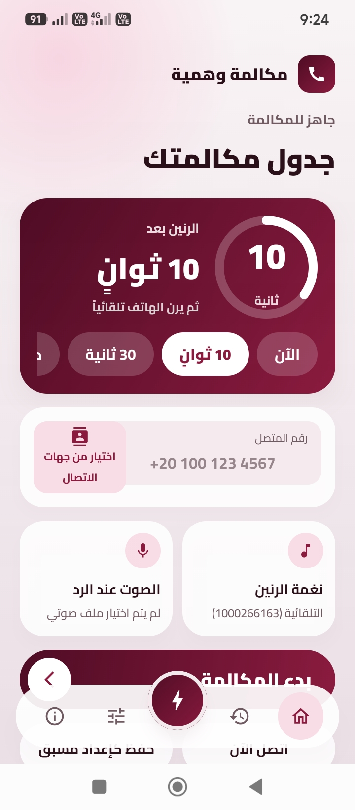
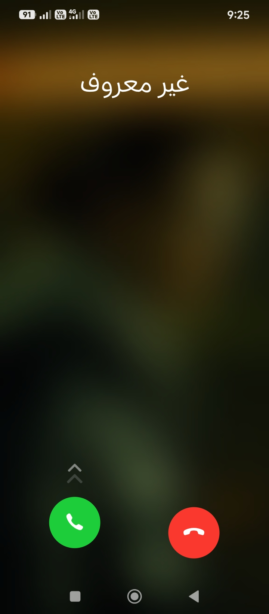
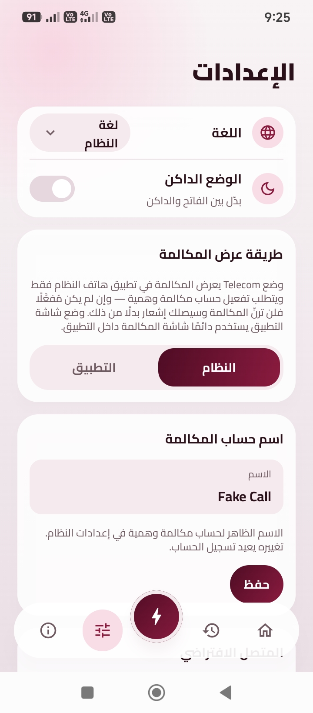
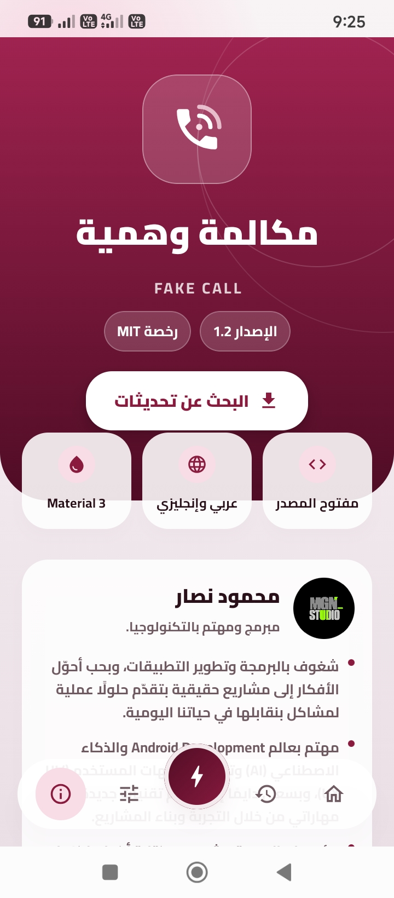

<div align="center">


# Fake Call

**Simulate a realistic incoming phone call — on your schedule, with your caller, and your audio.**

[](https://github.com/mgnegypt/fake-call/releases)
[](LICENSE)


**English** · [العربية](README.ar.md)

</div>

---

## Overview

Fake Call is an open-source Android app that simulates an incoming phone call at a time you choose, with a caller name and number you set, and optional audio that plays when you answer. Use it for privacy, entertainment, presentations, demos, and testing.

- **Android 11 (API 30) up to Android 17 (API 37)**
- **Arabic and English**, fully RTL / LTR
- **No ads, no analytics, no trackers, no data collection.** The only network use is checking GitHub for updates.

## Screenshots

<div align="center">

| Home | Incoming call | Settings | About |
|:---:|:---:|:---:|:---:|
|  |  |  |  |

</div>

## Features

- **Real call experience** — calls are raised through the Android Telecom framework and ring in the system dialer (after you enable the *Fake Call* account once in system settings). If the account isn't enabled, the app automatically falls back to its own full-screen call UI. See [docs/CALL_ENGINE.md](docs/CALL_ENGINE.md) for the decision and its limits.
- **Flexible scheduling** — ring now, after a delay, or at an exact time using exact alarms. Pending calls survive a reboot.
- **Audio on answer** — pick any audio file; it plays on the voice route when the call is answered.
- **Call history** — every simulated call is logged (answered / declined / completed).
- **Presets** — up to 5 quick presets, also available as launcher shortcuts and Quick Settings tiles.
- **Automation API** — trigger calls from Tasker, MacroDroid, or ADB.
- **In-app updates** — checks GitHub Releases, shows bilingual release notes, downloads the new APK, verifies its SHA-256, and installs it only when you tap. You can always fall back to the GitHub page.
- **Modern design** — Material 3 with a custom burgundy theme, light and dark modes, and a short animated intro that respects your system animation settings.

## Install

1. Download `fake-call-vX.Y.apk` from the [Releases page](https://github.com/mgnegypt/fake-call/releases).
2. Open it and allow installs from your browser or file manager if Android asks.
3. Open Fake Call and, optionally, enable the **Fake Call** entry under *Settings → Apps → Default apps → Phone app / call accounts* so calls ring in the system dialer.

## Automation API

Tasker, MacroDroid, or ADB can trigger a call with a broadcast:

| | |
|---|---|
| **Action** | `com.mgneg.fakecall.action.TRIGGER` |
| **Extras** | `caller_name` (String), `caller_number` (String), `delay` (Int, seconds) |

Missing extras fall back to your saved defaults.

```bash
adb shell am broadcast \
  -a com.mgneg.fakecall.action.TRIGGER \
  --es caller_name "Mom" \
  --es caller_number "+201001234567" \
  --ei delay 10
```

## Permissions explained

| Permission | Why |
|---|---|
| Phone state (`READ_PHONE_STATE`) | Register and query the Telecom call account |
| Contacts (`READ_CONTACTS`) | Let you pick a caller from your contacts (only when you use the contact picker; never uploaded) |
| Exact alarms | Ring at the exact scheduled time |
| Notifications (+ full-screen intent) | Show the incoming call over the lock screen (fallback UI) |
| Install packages | Install in-app updates you explicitly confirm |
| Internet | Update checks against GitHub Releases only |
| Boot completed | Re-schedule pending calls after a reboot |
| Battery optimization exemption | Keep scheduled calls from being delayed or killed by OEM battery saving (requested in the app, never forced) |
| Audio settings (`MODIFY_AUDIO_SETTINGS`) | Voice-route audio playback when the call is answered |

## Building from source

**Requirements:** JDK 17, Android SDK platform `android-37.0` + build-tools `37.0.0`, and Gradle 9.8.2 (via the wrapper).

```bash
./gradlew :app:assembleDebug        # debug build
./gradlew :app:testDebugUnitTest    # unit tests
./gradlew :app:assembleRelease      # release (needs signing env, below)
```

Release signing is read from environment variables (never commit secrets): `RELEASE_STORE_FILE`, `RELEASE_STORE_PASSWORD`, `RELEASE_KEY_ALIAS`, `RELEASE_KEY_PASSWORD`. In CI they come from GitHub Secrets; see [`.github/workflows/release.yml`](.github/workflows/release.yml). Dependency versions are pinned to the latest stable releases and recorded in [docs/VERSIONS.md](docs/VERSIONS.md).

## Privacy

Fake Call collects no data. Contacts, presets, history, and settings never leave your device. The only network requests are update checks to `api.github.com`, which you can ignore — the app works fully offline.

## Responsible use

Fake Call is meant for privacy, entertainment, presentations, and testing. Please don't use it to deceive, harass, or harm anyone, or to break any law. You are responsible for how you use it.

## How it was made

This app was designed, written, and programmed by **mgneg** together with **AI**. The idea, direction, design decisions, and testing are mine; AI tools helped write and refine the code and the documentation. The result is reviewed, built, and maintained by me.

## Inspiration

Fake Call is inspired by [Phony](https://github.com/DDOneApps/Phony) by DDOneApps. This is an independent implementation written from scratch; no source code, assets, or translations from that project are used.

## Changelog

See [CHANGELOG.md](CHANGELOG.md).

## Author

**Mahmoud Nassar (mgneg)** — developer and tech enthusiast, creator of [MGN Studio](https://github.com/mgnegypt).

## License

[MIT](LICENSE) — Copyright © 2026 mgneg.
Third-party notices: [THIRD_PARTY_NOTICES.md](THIRD_PARTY_NOTICES.md).
